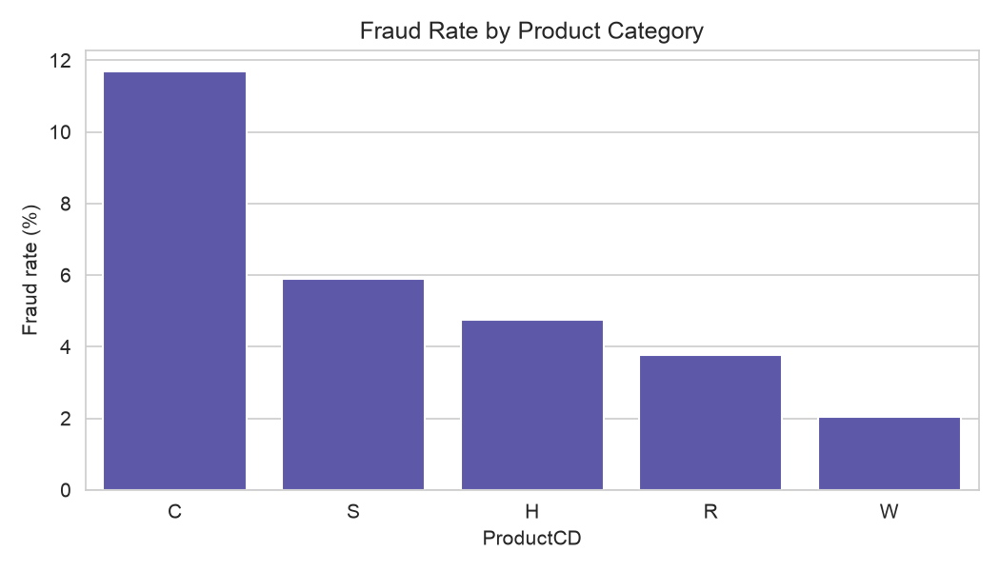
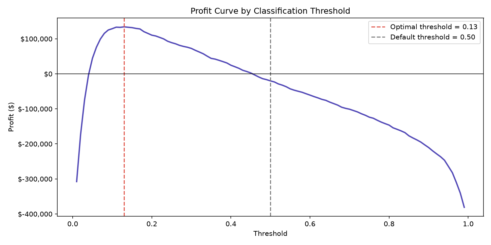
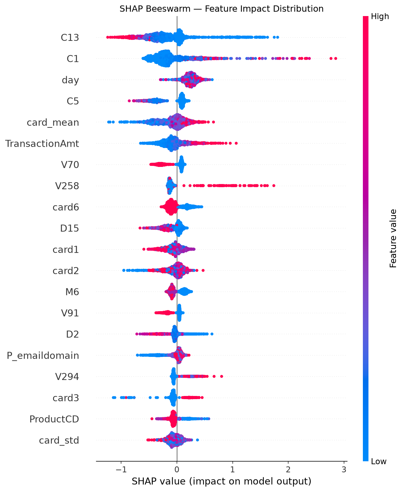
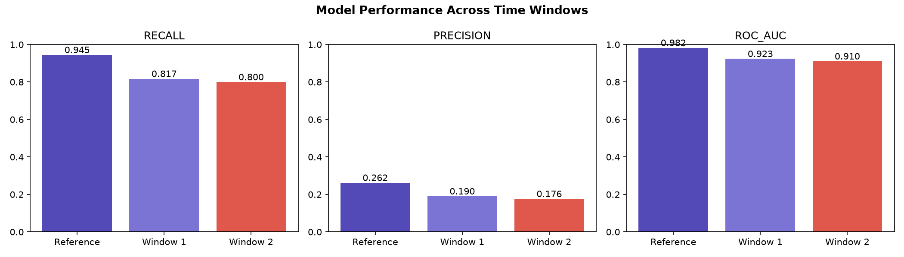

# 🔍 Fraud Detection — IEEE-CIS Dataset


> **End-to-end fraud detection pipeline** on 590,540 real transactions from
> Vesta Corporation, achieving ROC-AUC 0.91 and PR-AUC 0.53 (15x above the
> random baseline). Includes business-driven threshold optimization, SHAP
> explainability, drift monitoring and an interactive dashboard.

**🔗 Live dashboard:** [Open the app](#) &nbsp;·&nbsp; **📄 Model documentation:** [`model_card.md`](model_card.md)

---

## 💼 Business Problem

Card fraud costs the payments industry tens of billions of dollars every year.
This project builds a fraud scoring system designed around a business question,
not only a metric: *which decision threshold maximizes net profit once missed
fraud and false alerts are priced explicitly?*

- Detects **80% of fraudulent transactions** at the optimal operating threshold
- Generates **$134,120 net profit** on the test set vs. **-$20,200** with the default 0.5 threshold
- Provides **transaction-level explanations** (SHAP) to support GDPR-style explainability of automated decisions
- Monitors **model drift** across temporal production windows

---

## 📊 Key Results

| Metric | Value |
|--------|-------|
| ROC-AUC | **0.9103** |
| PR-AUC | **0.5303** (15x above random baseline of 0.035) |
| Recall at optimal threshold | **80.0%** |
| Optimal threshold | **0.13** (vs. default 0.5) |
| Net profit improvement | **+$154,320** vs. default threshold |

### Business Impact (test set, 88,581 transactions)

| Metric | Default (0.50) | Optimized (0.13) |
|--------|---------------|-----------------|
| Fraud detected | 49.1% (1,516 cases) | **80.0% (2,469 cases)** |
| False alerts | 1,264 | 11,563 |
| Revenue protected | $204,660 | **$333,315** |
| Net profit | -$20,200 | **+$134,120** |

> Cost assumptions: missed fraud = $135 (average transaction amount), false alert = $10 (analyst review).
> In production these would be calibrated with real chargeback and operations costs.

---

## 🖥️ Interactive Dashboard

A Streamlit app with three views:

- **Overview** — class balance, amount distribution, fraud rate by product and over time
- **Transaction Scoring** — pick a test transaction, see its fraud score, the decision at the optimal threshold, and a SHAP explanation of *why*
- **Model Monitoring** — performance degradation across temporal windows, profit curve and Evidently drift reports

<!-- Add a screenshot: save it as figures/dashboard.png and uncomment the next line -->
<!--  -->

---

## 🗂️ Project Structure

```
fraud-detection-ieee-cis/
├── raw_data/                  # Original IEEE-CIS files (not tracked)
├── processed/                 # Intermediate parquet/pkl artifacts (not tracked)
├── notebooks/
│   ├── 01_data_ingestion.ipynb          # Merge + missing-data analysis
│   ├── 02_eda.ipynb                     # Exploratory analysis
│   ├── 03_feature_engineering.ipynb     # Imputation + feature creation
│   ├── 04_modeling.ipynb                # SHAP CV selection + XGBoost + Optuna
│   ├── 05_threshold_optimization.ipynb  # Profit curve + business impact
│   ├── 06_explainability.ipynb          # SHAP global + local explanations
│   ├── 07_model_monitoring.ipynb        # Evidently drift detection
│   └── 08_dashboard_assets.ipynb        # Lightweight assets for the app
├── models/                    # Trained model
├── figures/                   # Visualizations used in this README
├── reports/                   # Evidently HTML drift reports
├── app/
│   ├── dashboard.py           # Streamlit dashboard
│   └── assets/                # Everything the app needs to run
├── requirements.txt           # Dependencies for the dashboard
├── model_card.md              # Model documentation
└── README.md
```

---

## 🔬 Methodology

### 1. Data & EDA
- Merged `train_transaction` (590,540 rows) with `train_identity` (144,233 rows)
- 414 of 434 columns contain missing values, and missingness is **not random**:
  - `id_*` columns: missing = no identity verification data
  - `D*` columns: missing = no prior event to measure
  - `V*` columns: missing in conditional blocks by transaction type
- Key EDA finding: the fraud rate *drops* during the high-volume spike (day ~20-25)
  because the product mix shifts toward lower-risk categories, not because
  there is less fraud per category

### 2. Feature Engineering
- Differentiated imputation that preserves missingness as signal
  (sentinel -999 + binary flags)
- Engineered features: `amt_zscore_card`, `amt_vs_card_mean`, `card_mean`,
  `card_std`, `hour`, `day_of_week`
- Final dataset: **0 nulls, 475 columns**

### 3. Feature Selection
- **SHAP CV**: SHAP importance averaged across 3 temporal folds
  (TimeSeriesSplit) to reduce selection bias
- **Correlation filter**: removed one of each pair with correlation > 0.95
- Result: **66 features** selected from 474

### 4. Modeling
- **XGBoost** with Optuna hyperparameter tuning (30 trials)
- Validation: **TimeSeriesSplit** (3 folds), which respects temporal order
- Class imbalance: `scale_pos_weight = sqrt(neg/pos) ≈ 5.2x`
- Temporal split: 70% train / 15% validation / 15% test

### 5. Threshold Optimization
- The default threshold (0.5) loses **$20,200** on the test set
- The profit curve finds threshold **0.13**, which yields **+$134,120**
- The FN/FP cost ratio of 13.5x justifies a lower threshold

### 6. Explainability (SHAP)
- Global: C13, C1, day, C5 and card_mean are the strongest fraud signals
- Local: waterfall plots explain individual transactions, including a missed fraud (false negative) analysis
- Engineered card-behavior features rank among the top contributors

### 7. Model Monitoring
- Evidently AI drift reports across 3 temporal windows
- ROC-AUC degrades from 0.982 (training period) to 0.910 (month 2)
- Retraining triggers: ROC-AUC < 0.88 or recall drop > 15%

---

## 📈 Key Visualizations

### Fraud Rate by Product


### Profit Curve — Threshold Optimization


### SHAP Global Feature Importance


### Model Performance Over Time


---

## ⚙️ Setup

### Run only the dashboard

The repository includes everything the app needs in `app/assets/`, so the raw data is not required.

```bash
git clone https://github.com/olgambencomo/fraud-detection-ieee-cis.git
cd fraud-detection-ieee-cis
pip install -r requirements.txt
streamlit run app/dashboard.py
```

### Reproduce the full pipeline

```bash
conda create -n fraud_env python=3.11 -y
conda activate fraud_env

pip install pandas numpy scikit-learn xgboost optuna shap evidently \
            streamlit plotly matplotlib seaborn pyarrow jupyter ipykernel

python -m ipykernel install --user --name fraud_env --display-name "Python (fraud_env)"
```

Download the data from [Kaggle IEEE-CIS Fraud Detection](https://www.kaggle.com/c/ieee-fraud-detection)
and place `train_transaction.csv` and `train_identity.csv` in `raw_data/`.
Then run the notebooks in order, from `01` to `08`.

> Note: the notebooks were developed with Evidently 0.7.x, whose API differs from earlier versions.

---

## 📋 Limitations

- V features are anonymized, so their business meaning cannot be verified
- No velocity features (real-time aggregations per card/device), the main gap vs. production systems
- Predicted probabilities are inflated by `scale_pos_weight`, so threshold optimization works on ranking quality rather than calibrated probabilities
- Concept drift is visible after ~2 months, so monthly retraining would be recommended
- Feature selection reduces but does not eliminate selection bias
- The public dataset is anonymized and contains no demographic variables, so no fairness audit was possible

See the full documentation in [`model_card.md`](model_card.md).

---

## 🛠️ Tech Stack


---

## 👩‍💻 Author

**Olga Bencomo** — Business Intelligence & Data Science
[LinkedIn](#) · [GitHub](https://github.com/olgambencomo)

